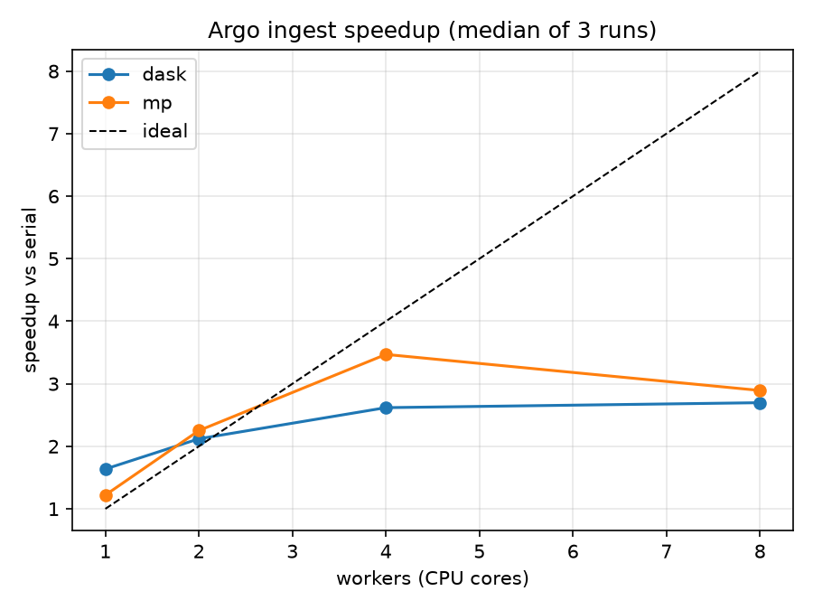

# Parallel processing of Argo ocean profiles (Indian Ocean, 2022)

A Python pipeline that cleans Argo float temperature/salinity profiles, stores them as Parquet,
computes monthly regional summaries, and benchmarks serial vs. parallel processing
(multiprocessing and Dask) on an 8-core laptop under WSL2 (Ubuntu 24.04).

## Data
- Source: Argo GDAC (https://data-argo.ifremer.fr), core profile files (NetCDF).
- Region: 30S-30N, 40E-120E (Indian Ocean and Indonesian seas). Period: 2022.
- Retrieved: 2026-11-22. Profiles selected from the global profile index: 11,633 (0.81 GB of NetCDF).
- Result: 11,253 files contributed rows; 380 files (3.3%) contributed none after filtering. The cleaned dataset has 8,332,260 rows (65 MB as Parquet).

**Cleaning rules**
- Adjusted values are preferred over raw values where available.
- Only values with Argo QC flag 1 (good) or 2 (probably good) are kept.
- Rows without pressure or temperature are dropped.
- Salinity outside 20 to 40 is set to missing. These bounds are my own plausibility check for this region, not an Argo standard. It affected 8,434 rows (0.10%), nearly all from float 1902198, whose salinity values of about 1.9 are physically implausible despite a good QC flag.

**Known limitations**
- 1,959,969 rows (23.5%) have no salinity. This is likely because some floats carry no salinity sensor, but I have not verified that.
- The monthly summary only uses pressure from 0 to 2100 dbar. 67,183 rows (0.8%) are deeper and 24 rows have a slightly negative pressure. They stay in the profile files but not in the summary.
- Summary bins: month, 5-degree latitude and longitude boxes, and depth bins 0-50, 50-200, 200-500, 500-1000, 1000-2100 dbar. Means are over all measurements in a bin, so floats with more levels weigh more.

**Columns (profile files)**
- pres: pressure (dbar); temp: temperature (degrees C); psal: practical salinity; time: UTC time of the profile; lat, lon: position (degrees); file: source file name.

## Pipeline
| Step | Script |
|---|---|
| Select profiles from the index | src/select_subset.py |
| Read and clean one profile file | src/process.py |
| Parallel ingest to Parquet, monthly summary | src/ingest.py, src/pipeline.py |
| Benchmark and plot | src/benchmark.py, src/plot_benchmark.py |
| Final dataset | src/make_dataset.py |
| Dashboard | src/dashboard.py |

## Benchmark

**Setup.** A fixed random sample of 10,000 of the 11,633 profile files was ingested (read, cleaned, written to Parquet in chunks of 200 files). Hardware: laptop with 8 logical cores and 7.6 GB RAM, running Ubuntu 24.04 under WSL2, data on a local drive. Each setting was run 3 times after one untimed warm-up run, and the table shows the median. Every one of the 27 runs produced exactly 7,117,858 rows, so all methods give identical output.

| Method | Workers | Median time (s) | Speedup vs serial | Speedup vs own 1-worker run |
|---|---|---|---|---|
| serial | 1 | 511 | 1.0x | |
| multiprocessing | 1 | 419 | 1.2x | 1.0x |
| multiprocessing | 2 | 227 | 2.3x | 1.9x |
| multiprocessing | 4 | 147 | 3.5x | 2.8x |
| multiprocessing | 8 | 177 | 2.9x | 2.4x |
| Dask | 1 | 312 | 1.6x | 1.0x |
| Dask | 2 | 241 | 2.1x | 1.3x |
| Dask | 4 | 195 | 2.6x | 1.6x |
| Dask | 8 | 189 | 2.7x | 1.7x |

**Findings.**
- Multiprocessing was fastest at 4 workers (about 2.8x faster than its own 1-worker run). At 8 workers it was slower than at 4 and the three repeats varied widely (119 to 194 s). The cause was not investigated. Possible explanations are that the 8 logical cores share fewer physical cores, that disk reads or the limited RAM are the bottleneck, or thermal throttling.
- Dask did not beat multiprocessing at any worker count in this setup.

**Limitations.**
- Run-to-run noise on this laptop is large. The three serial runs took 464, 511 and 538 s, and the 1-worker runs were faster than serial although they do the same work. The speedup vs serial is therefore uncertain by roughly 10 to 30%, and the speedup vs the method's own 1-worker run is the safer comparison.
- The benchmark was run before the salinity plausibility filter (see below) was added to the cleaning step. The filter is a cheap array operation, but the benchmark was not repeated with it.
- One machine, one dataset, one chunk size (200 files). Results may differ elsewhere.

## Reproduce
Always run scripts from the project root.

    python3 -m venv .venv && source .venv/bin/activate
    pip install -r requirements.txt
    # download the profile index and the files listed in data/raw/filelist_2022.txt
    python src/benchmark.py 10000
    python src/plot_benchmark.py
    python src/make_dataset.py

## Acknowledgement

These data were collected and made freely available by the International Argo Program and the national programs that contribute to it. (https://argo.ucsd.edu, https://www.ocean-ops.org). The Argo Program is part of the Global Ocean Observing System.

**Source data (retrieved from the Argo GDAC on 2026-11-22):**
Argo (2000). Argo float data and metadata from Global Data Assembly Centre (Argo GDAC). SEANOE. https://doi.org/10.17882/42182

**Argo data paper (optional reference):**
Wong, A. P. S., et al. (2020), Argo Data 1999-2019: Two Million Temperature-Salinity Profiles and Subsurface Velocity Observations From a Global Array of Profiling Floats, Frontiers in Marine Science, 7(700), https://doi.org/10.3389/fmars.2020.00700

**Note:** this repository contains derived data (quality-filtered subset and monthly summaries) produced by the code here. It is not an official Argo product.

## Licence

- Code: MIT License (see the LICENSE file).
- Processed dataset (deposited on Zenodo): CC BY 4.0. Please also acknowledge Argo as described above.
